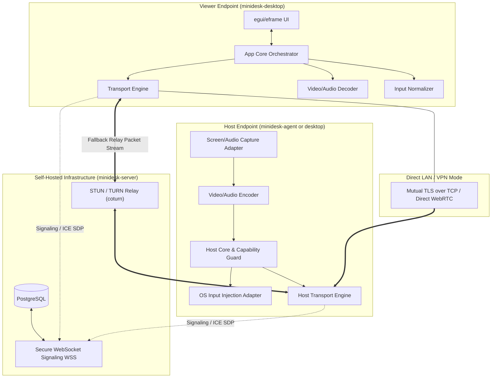
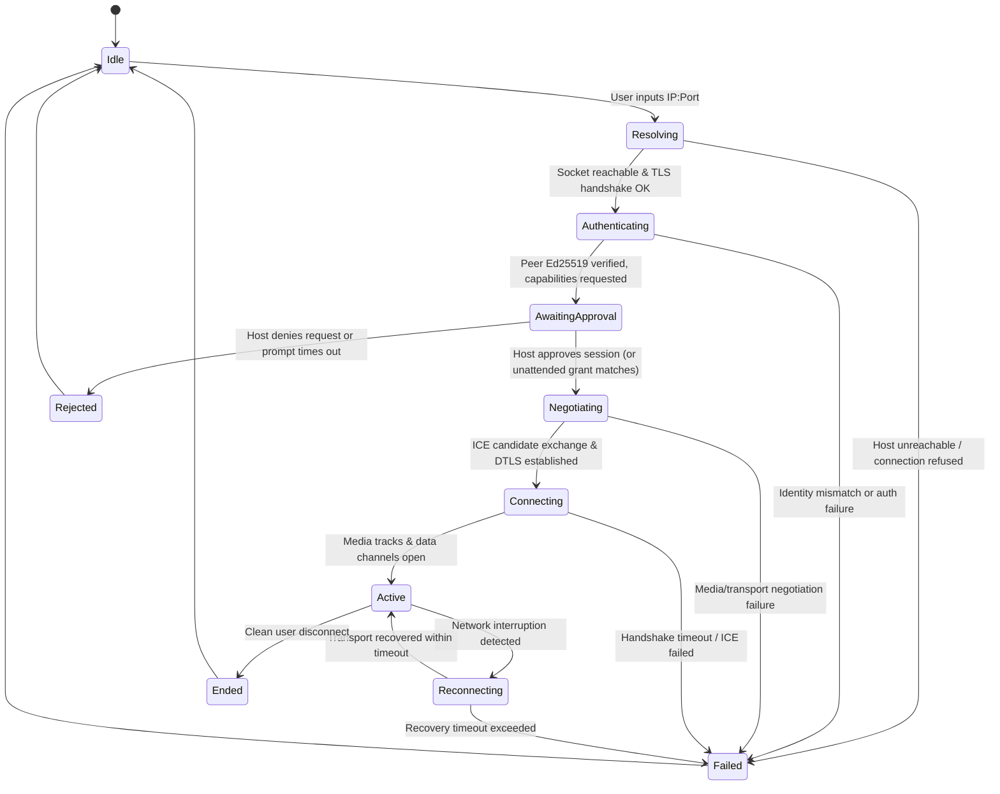

# miniDesk System Architecture & Technical Specification

## 1. System Vision & Target Users

miniDesk is an open-source, production-grade, modular remote desktop application engineered in Rust. Unlike legacy remote desktop software that relies on proprietary numeric routing IDs and opaque centralized relays, miniDesk is designed around **IP-based direct connections** (IPv4 and IPv6) with optional self-hosted relay and signaling infrastructure for NAT/firewall traversal.

### Target User Personas
1. **System Administrators & DevOps**: Require direct, low-latency, scriptable or saved IP connections to servers and workstations across local LANs, enterprise VPNs, or public static IPs without third-party cloud dependence.
2. **Privacy & Security Conscious Teams**: Require end-to-end cryptographic peer verification where signaling servers cannot inspect video, audio, keystrokes, or transferred files.
3. **Power Users & Remote Workers**: Require responsive multi-monitor viewing, smooth 60 FPS screen rendering, bi-directional clipboard sharing, safe file transfers, and low-latency input handling.

---

## 2. Technology Stack Evaluation

| Layer | Selected Technology | Rationale & Evaluation |
|---|---|---|
| **Language** | Rust 1.99+ (Stable) | Memory safety, zero-cost abstractions, thread safety without garbage collection, cross-platform compilation. |
| **GUI Framework** | `egui` (v0.29+) + `eframe` | Immediate-mode GUI ensuring deterministic, low-overhead rendering. Custom viewport integration with `wgpu` or OpenGL for zero-copy or minimal-copy frame rendering. |
| **Async Runtime** | `tokio` (Multi-threaded) | Industry standard for async networking, timers, and background task management; cleanly separated from the immediate-mode UI rendering thread. |
| **Media & P2P Transport** | `webrtc-rs` + Raw TLS/TCP fallback | Standard-compliant ICE (STUN/TURN), DTLS-SRTP for real-time video/audio tracks, SCTP data channels for low-latency input and reliable control. Raw TLS/TCP is supported for direct LAN streaming where WebRTC overhead is unnecessary. |
| **Serialization** | `prost` (Protocol Buffers v3) + `serde`/`serde_json` | Protobuf ensures strictly typed, backward/forward-compatible binary wire formats with deterministic sizing and zero ambiguity. JSON is restricted to REST administrative APIs. |
| **Local Storage** | `rusqlite` (SQLite 3 with WAL) | Embedded, zero-configuration relational storage for device profiles, trusted peer identities, preferences, and session audit logs. |
| **Server Storage** | `sqlx` + PostgreSQL | Robust async relational storage for self-hosted signaling, device registries, account authentication, and audit trails. |
| **Relay Infrastructure** | `coturn` (External RFC 5766/6156) | Battle-tested, high-performance TURN/STUN relay. Avoids re-implementing TURN from scratch in application code. |

---

## 3. Workspace Layout & Crate Dependency Graph

To guarantee that components remain decoupled, unit-testable, and free of circular dependencies, the workspace is partitioned into specialized crates:

```
miniDesk/
├── apps/
│   ├── minidesk-desktop/      # Native egui application entrypoint & window lifecycle
│   ├── minidesk-agent/        # Headless background service (host/unattended access)
│   ├── minidesk-server/       # Self-hosted signaling, auth & enrollment server
│   └── minidesk-cli/          # CLI tool for diagnostics, direct connects & automation
├── crates/
│   ├── minidesk-domain/       # Pure domain models (SessionId, DeviceId, Capabilities, NetworkAddress)
│   ├── minidesk-config/       # Configuration schemas, validation, defaults & migration
│   ├── minidesk-logging/      # Redacted structured tracing (tracing-subscriber)
│   ├── minidesk-security/     # Ed25519 identities, TLS/DTLS cert generation, crypto primitives
│   ├── minidesk-protocol/     # Protobuf schemas, framing, encode/decode & version guards
│   ├── minidesk-storage/      # SQLite repository implementations & migrations
│   ├── minidesk-platform-api/ # Platform abstraction traits (Capture, Input, Audio, Display)
│   ├── minidesk-platform-windows/ # Windows Desktop Duplication, SendInput, WASAPI
│   ├── minidesk-platform-macos/   # macOS ScreenCaptureKit, CGEvent, CoreAudio
│   ├── minidesk-platform-linux/   # Linux X11 (XShm/XTest) & Wayland (PipeWire/Portal)
│   ├── minidesk-codecs/       # Video/audio codec traits, VP8/VP9/AV1/Opus software wrappers
│   ├── minidesk-media/        # Media pipelines, frame rate pacing, jitter buffering
│   ├── minidesk-input/        # Input event validation, normalization, and safety release guards
│   ├── minidesk-clipboard/    # Bounded text/image clipboard sync manager
│   ├── minidesk-file-transfer/# Chunked, hashed (SHA-256) file transfer engine
│   ├── minidesk-transport/    # Network abstractions (Direct TCP/TLS, WebRTC PeerConnection)
│   ├── minidesk-signaling-client/ # WSS client for server-assisted ICE candidate exchange
│   ├── minidesk-app-core/     # Session state machine, capability coordinator, event dispatcher
│   └── minidesk-ui-egui/      # egui UI components, design tokens, viewport rendering widgets
└── tests/                     # Integration, protocol fuzzing & network simulation suites
```

### Dependency Flow Rules
1. `minidesk-domain` has **zero internal dependencies** and no platform/UI dependencies.
2. `minidesk-platform-api` defines traits; platform crates (`windows`, `macos`, `linux`) implement them.
3. `minidesk-app-core` depends on `domain`, `protocol`, `platform-api`, `transport`, `security`, and `storage`. It never references `egui` or concrete OS crates.
4. `minidesk-ui-egui` communicates with `minidesk-app-core` exclusively via asynchronous message channels (`tokio::sync::mpsc`). The UI thread never blocks on I/O.

---

## 4. Endpoint, Transport & Server Architecture



---

## 5. Connection & Session State Machine

Every connection transition is deterministic and strictly guarded:



### Safe Disconnect & Cleanup Invariants
- When transitioning to `Ended`, `Failed`, or `Rejected`, the host input adapter **immediately dispatches a hardware key/mouse release reset** for all currently pressed virtual keys and buttons.
- All active media capture threads and encoding loops are cleanly shut down using cancellation tokens (`tokio_util::sync::CancellationToken`).
- Partial file transfers are aborted and temporary files (`.part`) are deleted unless an explicit resume token exists.
- Ephemeral cryptographic session keys are securely zeroized (`zeroize` crate).

---

## 6. Authentication, Identity & Capability Model

1. **Cryptographic Device Identity**:
   - Each miniDesk installation generates an **Ed25519 keypair** upon initialization.
   - The public key fingerprint (Base58 or hex-encoded SHA-256) forms the immutable `DeviceId`.
   - Private keys are stored in system credential storage (Windows Credential Manager / DPAPI, macOS Keychain, Linux Secret Service / Keyring).
2. **Mutual Verification**:
   - In direct IP connections, mutual TLS is established where the certificate's public key must match the expected peer's Ed25519 identity.
   - For unknown hosts, a **First-Use Trust (TOFU)** modal displays the cryptographic fingerprint and IP address, requiring explicit user confirmation.
3. **Granular Capability Sets**:
   Authorization is never all-or-nothing. Every session negotiation exchanges a `CapabilitySet` bitmask:
   - `CAP_SCREEN_VIEW` (Watch only)
   - `CAP_MOUSE_CONTROL` (Pointer movement, clicks, scrolling)
   - `CAP_KEYBOARD_CONTROL` (Keystrokes, keyboard shortcuts)
   - `CAP_CLIPBOARD_READ` / `CAP_CLIPBOARD_WRITE` (Host -> Viewer and Viewer -> Host)
   - `CAP_FILE_DOWNLOAD` / `CAP_FILE_UPLOAD`
   - `CAP_AUDIO_LISTEN`
   - `CAP_MONITOR_SWITCH`
4. **Host-Side Enforcement**:
   - The host's packet dispatcher checks capabilities on every single packet. If a viewer sends an input packet without `CAP_MOUSE_CONTROL`, it is dropped and logged as a security violation.

---

## 7. Protocol & Wire Decisions

miniDesk uses **Protocol Buffers v3 (`prost`)** with framed messages.

### Channel Allocation
- **Track 0 (WebRTC Video)**: Real-time video stream (VP8/H.264/AV1).
- **Track 1 (WebRTC Audio)**: Real-time audio stream (Opus 48kHz).
- **DataChannel `control` (Reliable, Ordered)**:
  - `ClientHello`, `ServerHello`, `Authenticate`, `CapabilityRequest`, `CapabilityGrant`, `SessionHeartbeat`, `SessionClose`.
- **DataChannel `input_ordered` (Reliable, Ordered)**:
  - Mouse clicks (Down/Up), Keyboard keys (Down/Up), Modifier updates, Key release resets.
- **DataChannel `input_unreliable` (Unreliable, Max Retransmits 0)**:
  - High-frequency mouse cursor movement (`MouseMove { x: f32, y: f32 }`) to avoid head-of-line blocking.
- **DataChannel `clipboard` (Reliable, Ordered)**:
  - Text and image payload chunks with length limits (max 16 MB).
- **DataChannel `file_transfer` (Reliable, Ordered, Flow-Controlled)**:
  - Chunks of 64 KB, credit-based backpressure, SHA-256 file manifest and block checksums.

---

## 8. Platform Adapter Implementation Strategy

### 8.1 Windows (Phase 2 Baseline)
- **Capture**: `IDXGIOutputDuplication` (Desktop Duplication API) via `windows` crate. Yields GPU surface buffers (`ID3D11Texture2D`), providing 60 FPS hardware capture with sub-frame latency.
- **Input**: Win32 `SendInput` API. Handles scan codes (`KEYEVENTF_SCANCODE`) to support non-ASCII keyboards and gaming/system shortcuts correctly.
- **Elevation Handling**: Detects whether the active foreground window is elevated (UIPI). Accurately reports to the remote user if an input operation is blocked by Windows security rather than silently failing.
- **Audio**: WASAPI Loopback (`IAudioClient`) capturing master system audio output.

### 8.2 macOS (Phase 6)
- **Capture**: `ScreenCaptureKit` (macOS 12.3+), supporting high-resolution display streaming with native OS cursor compositing.
- **Input**: `CGEventCreateMouseEvent` and `CGEventCreateKeyboardEvent` via Accessibility APIs.
- **Permissions**: Proactive verification and user guidance for `Screen Recording` and `Accessibility` system permissions.

### 8.3 Linux (Phase 6)
- **X11**: `XShm` (MIT-SHM shared memory) for screen capture, `XTestFakeKeyEvent` / `XTestFakeMotionEvent` for input injection.
- **Wayland**: PipeWire screen capture orchestrated via XDG Desktop Portal (`org.freedesktop.portal.ScreenCast`), and input injection via `org.freedesktop.portal.RemoteDesktop` where available.

---

## 9. Security Threat Model & Mitigations

| Threat Vector | Description | Mitigation Strategy |
|---|---|---|
| **Man-in-the-Middle (MITM)** | Attacker intercepts IP connection or proxies traffic. | Mutual Ed25519 authenticated TLS / DTLS. Certificates are generated from device identity keys and validated against pinned fingerprints. |
| **Malicious Signaling Server** | Compromised self-hosted server attempts to swap SDP to reroute video to unauthorized third party. | Out-of-band cryptographic peer binding: The peer's WebRTC DTLS certificate fingerprint is signed by the peer's Ed25519 identity key. The server cannot forge this signature. |
| **Path Traversal / Arbitrary File Write** | Malicious client sends `../../Windows/System32/evil.exe` via file transfer. | Strict path normalization: File transfers only specify base file names; absolute paths and path traversal components (`..`, `/`, `\`, null bytes) are stripped. Files are saved into an explicitly user-selected sandbox directory. |
| **Stuck Keys / DoS on Disconnect** | Network drops while `Ctrl` or `Enter` is held down. | Automatic key state tracking table on the host. When connection drops or times out, synthetic key-up events are emitted for all currently down keys. |
| **Denial of Service (Memory Exhaustion)** | Peer floods host with giant Protobuf packets or file chunks. | Framing layer enforces hard limits (max message size: 64 KB for control, 16 MB for clipboard). Streaming chunk buffers are fixed-size and bounded. |
| **Credential & Secret Leakage in Logs** | Tracing logs inadvertently capture passwords, clipboard contents, or keystrokes. | Specialized `minidesk-logging` crate implements redaction filters. Event payloads omit raw key codes and clipboard strings. |

---

## 10. Implementation Phases & Acceptance Criteria

- **Phase 0: Architecture & Feasibility Validation** (Current)
  - *Criteria*: Full specification published, workspace layout defined, technical risks assessed, user sign-off.
- **Phase 1: Project Foundation & Workspace Setup**
  - *Criteria*: GitHub repo created, workspace compiles, `minidesk-domain`, `minidesk-config`, `minidesk-logging` implemented, egui desktop shell runs, CI passes.
- **Phase 2: Windows End-to-End LAN MVP**
  - *Criteria*: Direct IP connect over LAN, Desktop Duplication capture, VP8 software encoding/decoding, egui remote viewport rendering, mouse/keyboard input with safety releases, explicit consent dialog.
- **Phase 3: Self-Hosted Internet Connectivity & Control Plane**
  - *Criteria*: `minidesk-server` functional with WSS signaling, device enrollment, ICE/STUN/TURN fallback (coturn), anti-substitution peer identity validation.
- **Phase 4: Windows Complete MVP Features**
  - *Criteria*: Bi-directional clipboard, chunked file transfer with SHA-256 verification, WASAPI audio streaming, multi-monitor switching, SQLite saved devices & history.
- **Phase 5: Unattended Access & Security Hardening**
  - *Criteria*: Background service daemon, pre-shared key / password enrollment, auto-approval under policy, privilege boundary separation.
- **Phase 6: macOS & Linux Platform Adapters**
  - *Criteria*: ScreenCaptureKit and X11/Wayland PipeWire implementations functioning with OS permission checks.
- **Phase 7: Production Readiness, Packaging & Release**
  - *Criteria*: Fuzz testing passed, Windows NSIS/WiX installer built, GitHub release tagged with binaries via `gh release create`.
